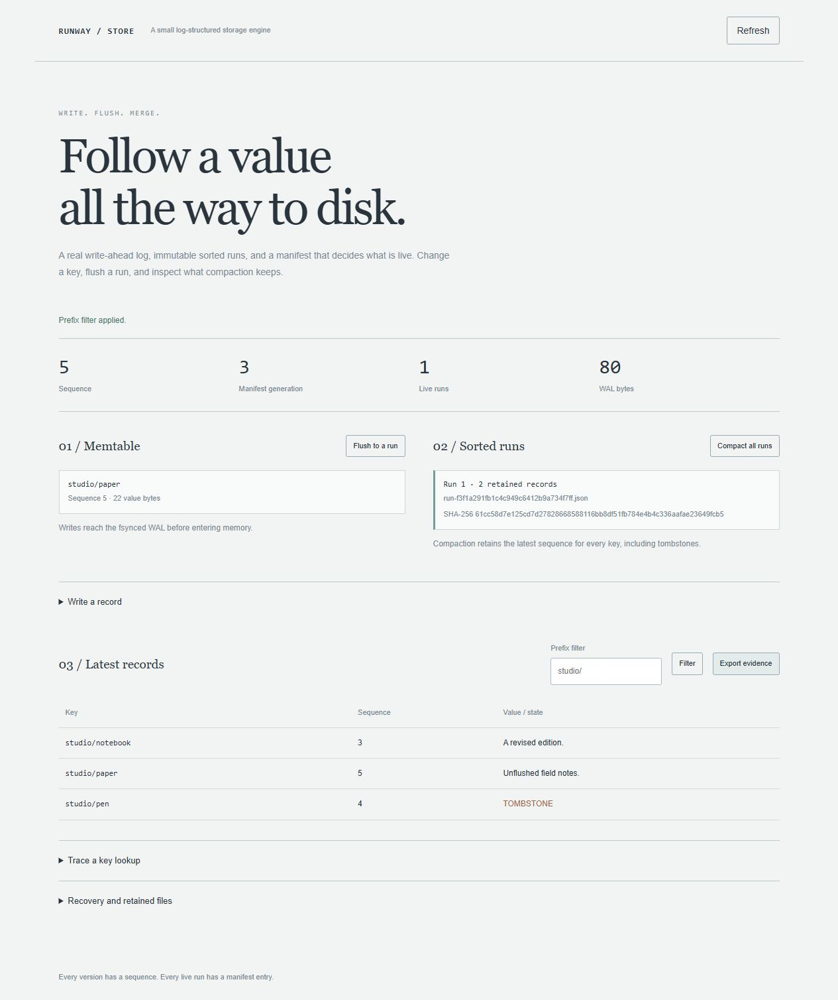

# Runway Store

A small persistent log-structured key/value engine built with the Python standard library. It uses an fsynced write-ahead log, an in-memory table, immutable sorted JSON runs, and an atomically replaced manifest. The browser exposes writes, tombstones, flushes, compaction, prefix scans, and lookup provenance.



## Run

```sh
python run.py --port 8000
```

Open http://127.0.0.1:8000. Requires Python 3.10+; Node 22+ is only needed for the JavaScript check. No package installation is required. The ignored `data/` directory persists the workspace; `--data another-directory` chooses an independent one.

## Try a storage lifecycle

1. Write `studio/notebook = A first edition.` and `studio/pen = Blue ink.`
2. Flush the memtable. Both records become an immutable sorted run, and the WAL resets.
3. Update the notebook and write a tombstone for the pen. Flush again.
4. Compact. Four stored versions become two latest records; the pen's tombstone is retained.
5. Write another key without flushing, stop and restart the server, and observe WAL replay.

Two clients editing the same workspace use a global expected sequence. A stale write returns 409 and leaves the WAL unchanged. Refresh before retrying. There are no idempotency keys: if an acknowledgement is lost, refresh and inspect the sequence/value before deciding what to do next.

## Storage protocol

**Write:** validate the key/value and expected sequence, append one WAL frame, flush and fsync the file, then update the memtable. The frame contains three big-endian 32-bit integers—payload length, its bitwise complement, and CRC-32—followed by canonical JSON `{key,value,sequence}`. A null value is a tombstone. UTF-8 text values may be empty and may contain newlines.

**Flush:** write and fsync a new sorted run; atomically replace the manifest with the new run descriptor and durable sequence; clear the memtable and atomically reset the WAL. If the process exits after the manifest replacement but before WAL reset, recovery skips frames at or below the durable sequence. A run written before publication remains an unreferenced file.

**Compact:** first flush pending writes, merge all live runs by highest sequence per key, write a new sorted run, then atomically publish a manifest referencing only that run. Tombstones remain so the latest deleted state stays inspectable. Old run files are retained as unreferenced files; automatic garbage collection is not implemented.

**Recover:** validate the manifest, verify SHA-256 for every referenced run, load sorted records, then replay complete CRC-valid WAL frames above the durable sequence. Only an incomplete final frame is truncated. Invalid complete-frame headers, checksums, or sequence continuity stop startup rather than skipping data. A missing manifest in an existing workspace is rejected.

The process holds an exclusive `writer.lock` created with `O_EXCL`. Clean shutdown removes it. After a crash, verify that its owner has stopped before manually removing the stale lock. Removing a live writer's lock can permit concurrent processes and corrupt the workspace. Requests within one process are serialized with a reentrant lock. This lock-file protocol is intended for local filesystems, not distributed storage.

## Deliberate limits

- Up to 10,000 writes, 1,000 distinct retained keys including tombstones, and 200 live runs. Compact when the live-run limit is reached.
- ASCII keys of 1–64 characters, starting with a letter/digit, followed by letters/digits/dots/underscores/slashes/hyphens. Keys are logical identifiers and never filesystem paths.
- Text values up to 4,096 UTF-8 bytes; null means deletion. HTTP request bodies are capped at 16 KB, so JSON escaping can make some otherwise-valid values exceed the HTTP boundary.
- Runs are loaded into memory. Lookup uses binary search over each cached sorted run and chooses the highest sequence; its trace counts logical probes, not physical disk reads. Prefix scans materialize the latest retained-key map.
- There are no transactions spanning multiple keys, snapshots, compression, Bloom filters, background compaction, authentication, or encryption. The server binds to loopback and exposes only fixed assets and API routes.
- File contents are fsynced, but directory entries are not. Process-exit recovery is tested; power-loss, filesystem, and hardware durability are not guaranteed. Windows sharing conflicts during atomic replacement receive five bounded retries.
- CRC-32 and SHA-256 detect accidental changes, not malicious administrators. Run checksums are verified on startup, not continuously. Lost/truncated files outside the documented torn-tail case cannot be reconstructed from checksums.

An I/O error while appending closes the store to avoid continuing after an uncertain write. Stop and reopen the workspace before retrying. For backups, stop the server and copy the whole data directory. Do not edit the manifest or WAL in place.

## API

| Method | Path | Input / result |
| --- | --- | --- |
| GET | `/api/state?prefix=studio/` | Latest filtered records, memtable, run descriptors, WAL/recovery counters |
| GET | `/api/lookup?key=studio/notebook` | Latest record or null, source, logical probe list |
| POST | `/api/records` | `{key,value,expectedSequence}`; 201 on append, 409 on stale sequence |
| POST | `/api/flush` | `{}`; publish pending values |
| POST | `/api/compact` | `{}`; flush, then merge live runs |

Evidence exports are diagnostic snapshots, not restorable backups. They include values, including unflushed values and tombstones, and reflect the applied prefix filter for the latest-record list. Global storage counters and memtable remain unfiltered.

## Verification

```sh
python -m unittest discover -s tests -v
npm run check
```

Eleven tests cover WAL replay, every partial-tail cut of a frame, complete-frame/run corruption, flush and compaction publication boundaries, 20 concurrent CAS writes with one winner, exclusive writer ownership, 200 randomized updates against a dictionary through flushes/compactions/restarts, and HTTP lifecycle/bounds. Three child processes exit abruptly with `os._exit` after WAL append, run creation, or manifest publication; recovery retains the committed records after the confirmed-dead child's stale lock is removed.

CI runs Python 3.11/3.13 on Linux and Windows. Browser verification covers two generations, tombstones, compaction, a second client's stale write, prefix filtering, lookup provenance, and export. An independent Python parser verified the exported three-record example directly against the live run's SHA-256 and WAL's frame lengths, complement, CRC, and sequence.

Conceptual reference: [RocksDB Overview](https://github.com/meta/rocksdb/wiki/RocksDB-Overview) and [Write-Ahead Log](https://github.com/facebook/rocksdb/wiki/Write-Ahead-Log-%28WAL%29). This project implements its own small JSON-run format and does not use or claim compatibility with RocksDB.
